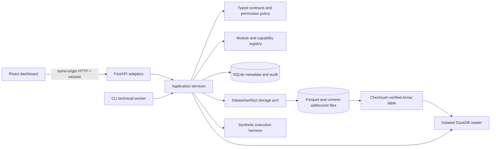

# Platform architecture

Document ID: ARCH-001 · Version: 2 · Updated: 2026-10-20 · Language: en (canonical)

Translation: [Spanish](../../es/architecture/platform.md), synchronized with ARCH-001 v2. Scope: III.A design baseline; implementation and test evidence belong to the [acceptance register](../../phase-iii/acceptance.md). A design statement does not certify an operational capability.

## 1. Diagnosis and constraints

The accepted Phase II baseline (`f8f4ff8`) contains scientific documentation, 53 examined works and H-00–H-24, without application code, installed laboratory or financial experiments. Preserve those documents and their unfavorable findings. C1/C3 remain primary questions, C2 a risk comparison, C4/C5 conditional reserves; architecture must not encode a winner, fixed asset count, venue or sampling frequency.

The [Phase III request](../../phase-iii/REQUEST.es.md) authorizes architecture followed by a working platform and synthetic technical tests. Financial datasets, empirical financial experiments, real model training, prospective paper trading, production agents, spending and live orders remain outside scope. USD is the accounting reference; USDT/USDC are separate instruments with explicit valuation requirements. Spain remains the initial jurisdiction, without certifying any provider or product.

Functional requirements are hypothesis discovery, dataset provenance, reproducible transformations and technical runs, inspectable results/failures, module discovery and a genuine web interface. Nonfunctional requirements are replaceable implementations, temporal integrity, bounded resource use, persistent recovery, typed validation, explicit authorization, auditability, reproducible installation and bilingual maintenance. No latency, throughput or financial-performance promise is made before measurement.

## 2. Deployment and technology choices

Use one repository and a **modular monolith** with an HTTP process and a separate worker. They share contracts, application services and durable storage, not hidden process-local job state.

| Layer | Baseline and reason | Alternative/reconsideration gate |
|---|---|---|
| Runtime/API | Python 3.12, FastAPI, Pydantic 2: typed domain validation and generated API schema | Framework substitution through application services; pin resolved versions |
| Metadata | SQLAlchemy 2 + Alembic; SQLite on one host, explicit transactions | PostgreSQL when measured concurrency/deployment needs justify it; not certified by SQLite tests |
| Data/artifacts | Immutable content-addressed Parquet and files; DuckDB analytical reader | Object storage via storage port when retention/volume requires it; SQL is not a tick warehouse |
| Web | React + TypeScript + Vite, built SPA served on the API origin | Next.js server rendering adds no essential value for the authenticated local dashboard |
| Charts | Adapter around Lightweight Charts, required attribution preserved | Replace renderer without changing scientific transforms; advanced drawings are not assumed included |
| Jobs | Durable SQL job records and CLI worker | Distributed broker/scheduler only after concurrency or scheduling requirements justify it |
| Simulation | Bounded deterministic synthetic spot-ledger harness | Adopt a mature engine behind a port before empirical backtesting; do not grow the harness into an unreviewed financial engine |

Official-source comparisons and license findings accompany the technology research record. A dependency's license, supported Python versions and pinned release must be checked before installation; framework adoption, library integration and reuse of patterns are separate decisions. No Redis, distributed event streaming, Kubernetes, autonomous orchestration framework or exchange SDK is needed for this baseline.

## 3. Domain boundaries and dependency map

All fifteen domains in the request are represented; domains need not become fifteen packages. “Prepared” means contracts/records, not a working financial feature. All depend on Core contracts; none may depend on Web implementation.

| Domain | Responsibilities and public dependency | III scope / later extension |
|---|---|---|
| Core Platform | Configuration, contracts, permissions, manifests, errors, events | Working foundation; no dynamic third-party code loader |
| Market Data | Instrument, timestamp, quality, dataset and storage contracts | Synthetic generation/validation/storage; market connectors future |
| Research Lab | Hypotheses, transforms and technical comparisons; Data + Experiments | Working synthetic laboratory; scientific protocols IV |
| ML & Models | Versioned fit/predict input/output and model metadata; Data contracts | Interfaces and technical substitutions; financial fitting future |
| Experiment Management | Frozen specs, jobs, environment/code/seed, results and artifacts | Working durable technical lifecycle; no unlimited search |
| Backtesting | Strategy/risk/execution ports; Data + Portfolio + Risk contracts | Technical harness only; mature engine integration future |
| Paper Trading | Prospective virtual accounting, adapter/reconciliation requirements | First-class inactive module; future data feed and execution adapter |
| Trading Engine | Validated intentions, authorized execution/reconciliation | Inactive; no live adapter, credentials, routes or funded account |
| Risk Management | Independent pre-order decisions, exposure/margin contracts | Synthetic checks; operational loss limits and liquidation models future |
| Portfolio Analytics | Currency-aware balances, positions, costs, attribution | Technical spot accounting; general analytics/margin future |
| Charting & Technical Analysis | Render typed series; scientific computation via Lab | Reusable chart; technical indicators/extensions through capabilities |
| News Intelligence | Versioned sources, event/entity/sentiment outputs; Data contracts | Future ingestion and analysis; no text instructions executed |
| AI Researcher | Proposal records, evidence, duplicate links, budgets, review state | Records/permissions only; autonomous loop and model calls future |
| Alerts & Notifications | Consume typed operational events, deduplication/delivery policy | Inspectable failures/audit; external notifications future |
| Web Dashboard | Section descriptors and typed API clients | Working views for actual services; future entries visibly inactive |

Application services depend on public contracts and injected ports. Infrastructure adapters implement those ports. Module implementations must not import other modules' private persistence or UI code. The composition root wires explicit built-in implementations; manifests declare ID, semantic version, required dependencies and capability states. Registration rejects missing dependencies, duplicates and cycles. Capability discovery does not execute arbitrary imported packages.

Synchronous queries return validated results/errors. A typed in-process event bus supports optional handlers; durable audit/job records remain the source of history. The bus is neither a distributed queue nor an exactly-once delivery guarantee. Future external event delivery needs a transactional outbox, idempotent consumers and replay policy before adoption.

## 4. Data and public contracts

Contracts have schema versions, stable identifiers and validated units. Major incompatible versions are rejected; additive evolution must preserve consumers and be tested. Public errors include a stable code, safe message and correlation ID. Decimal amounts and explicit currencies prevent implicit USD/stablecoin equivalence; chart floats are display values, not accounting authority.

Market observations separate event time, first publication, provider availability and local receipt; transformations, signals, decisions and fills carry their own timestamps. Use timezone-aware UTC; unknown timestamps remain unknown, never fabricated from event time. An information-availability policy chooses the observable vintage, not the latest revised value. Synthetic fixtures must exercise delayed availability, invalid ordering, duplicate bars, missing values and instrument identity. No interval, venue or asset list is hard-coded into the domain.

Core entities: hypothesis/source reference; instrument; dataset version/partition/quality report; transformation specification/version; model/strategy version; frozen experiment specification; job attempt; result/artifact; proposal; audit event. Dataset descriptors include provenance, synthetic classification, content hash, schema, partition role and temporal coverage. Artifacts include checksum, media type and producing run. Historical versions are append-only; lifecycle status changes are separate transactions and do not overwrite old configuration/results.

Ports cover storage/query, transformations, model fit/predict, signal/strategy decisions, execution, costs, financing/margin and risk checks. Orders, fills, positions and portfolios are distinct records. In the target architecture, a strategy emits a signal or intention; risk and execution independently validate actionable targets. The implemented v1 Signal is only a synthetic quantity target; general prediction, portfolio-target and order-intention semantics must be specified before a financial adapter is admitted (see the supplementary review). The same intention contract may serve historical, prospective and live modes, but fills, latency, rejection, partial execution, funding and reconciliation remain adapter-specific. Unsupported contracts must reject explicitly rather than silently simulate zero costs or perfect fills.

Partition metadata may be browsed; **final/holdout payload access is denied to every role in III**, including administrator and agent. API, worker and storage/query service paths enforce the same rule. There is no market CSV upload or general SQL execution endpoint. Future holdout opening requires a separately authorized, audited policy and immutable evaluation record, not changing a UI flag.

## 5. Reproducible laboratory and durable work

The process captures its loaded software identity and rejects changed executable sources/dependencies until API and worker restart. A run freezes exact hypothesis references (kind, ID, version, hash), dataset and transformation hashes, parameters, seed, code revision/dirty-state identity, dependency/environment versions and protocol version before execution. Reports distinguish technical success, failure, negative and inconclusive outcomes from financial validation. Comparable runs expose differences instead of ranking unrelated configurations as scientific evidence. Deterministic reproduction compares stable inputs/results separately from timestamps and run IDs.

The technical runner accepts bounded synthetic tasks only. Persist queued/running/succeeded/failed/interrupted states with timestamps, result/error and audit history. Claim atomically so two workers cannot own one job. Persist completion conditionally to prevent duplicate outputs. After a worker crash, abandoned work is explicitly recovered as interrupted or failed and may be retried as a new linked attempt; never report success or silently replay an external side effect. Transaction/file ordering must avoid publishing descriptors for missing artifacts; detect orphaned content during maintenance.

Temporal split and walk-forward specifications describe ordered development/validation/final partitions and availability constraints. This phase prepares and tests their contracts on synthetic records, not an empirical search or repeated holdout evaluation. Sampling frequency, horizon, number of trials and candidate admissions remain decisions under the accepted Phase II process.

## 6. Web and chart integration

The dashboard consumes real API responses for overview/health, H-00–H-24, datasets/provenance, technical experiments/jobs, results/artifacts, charts, module capabilities and audit/errors. Empty, loading, unauthorized and failed states must be visible. Synthetic data and technical outcomes are labelled throughout. An unimplemented feature is an inactive documented capability, never a button pretending to execute it.

Use section descriptors and shared typed API access rather than embedding research logic into pages. A chart adapter receives normalized time series, candles/volume when available and overlay descriptors. Indicators are computed by versioned backend transformations, not hidden visual calculations. Rendering can be swapped independently. Future drawings, multi-chart synchronization, comparisons, watchlists, screeners, calendars, alerts, order markers and prediction overlays are separate capabilities with their own data/permissions; the initial renderer does not claim TradingView parity.

## 7. Security, agents and operational isolation

Default to loopback, one local owner and deny-by-default permissions. Generate a local bootstrap credential stored outside Git; never request exchange secrets. Use server-side sessions, HttpOnly cookies, expiration/revocation and same-origin CSRF protection; secure cookies and TLS are prerequisites for nonlocal deployment. Admin, researcher, viewer and agent roles have explicit allowlists. Agent access is limited to proposal/metadata capabilities, never order, holdout or arbitrary tool execution. State-changing endpoints validate authorization independently of the UI.

Validate bounded payloads, safe artifact IDs/paths, resource limits and unexpected fields. Do not expose arbitrary shell, code, URL fetch, filesystem or SQL inputs. Redact secrets and safe error responses; detailed failures are controlled diagnostic records. Persist service/domain authorization failures, authenticated CSRF denials and sensitive mutations. Current ingress checks for host/origin, body size and schema do not all persist audit events; complete ingress security monitoring remains a deployment admission requirement. Audit records provide traceability, not tamper-proof protection against a host administrator. A compromised local OS is outside this deployment's isolation guarantee.

Research proposals preserve source URLs/hashes, provenance, model/prompt version when applicable, rationale, falsifier, duplicate relationships, requested resource budgets and review status. External text is untrusted data. No tool instruction is executed from it; a proposal cannot amend permissions, expand trial budgets, rewrite live strategy/risk settings or authorize itself. Future autonomous agents need bounded grants, consumption accounting, review and revocation before activation.

Historical research, prospective paper and live execution require distinct authorized runtime identities, adapter allowlists, storage namespaces and risk/control policies. III ships no live-capable dependency path: a boolean `live=true` cannot activate an absent adapter. Future paper requires first-class service/state recovery and reconciliation, synthetic capital separated from real capital, then separate approval. Future live additionally needs independently approved access, limits, kill switch and reconciliation; shared interfaces do not bypass those gates.

## 8. Installation, recovery, costs and implementation order

Keep backend source, frontend, tests, migrations and EN/ES docs in one repository. Commit dependency lockfiles and schema migrations; ignore runtime data, credentials, caches and generated artifacts. Installation must work from pinned dependencies, initialize a fresh database, import preserved hypothesis identities, build the SPA and start API plus optional worker using documented commands. The public health endpoint reports basic process liveness only. Application composition checks schema compatibility before startup; authenticated data/status requests exercise storage. Liveness does not guarantee ongoing storage readiness. Startup rejects incompatible schema/configuration instead of destructively recreating data.

Use migration-before-start, database backup before upgrades, controlled rollback/restore and a tested fresh-database migration path. Single-host SQLite backups must respect active writes/WAL; copy database and artifact manifests coherently. Failure recovery reconciles interrupted jobs and missing artifacts without deleting failed history. Structured logs, correlation IDs, persisted error states and a health view are the initial observability surface; email/webhooks/24-hour incident coverage are future operational requirements, not provided service guarantees.

Personal infrastructure and open-source packages incur no newly contracted service cost here; CPU, disk, maintenance and development still have costs. Start with bounded fixtures, one worker and local storage. Measure resource use before adding cloud or parallel workers. Separate historical-data acquisition, development/validation and recurring operation budgets. Premium feeds, LLM calls, managed PostgreSQL and cloud deployment are unpurchased options subject to explicit authorization.

Implement in dependency order: **(1)** approved architecture/licensing and contracts; **(2)** configuration, security, registry, storage/migrations; **(3)** datasets, hypotheses, laboratory/jobs and synthetic harness; **(4)** API and worker integration; **(5)** UI/chart integration; **(6)** clean installation, security, recovery and A–F evidence. Parallel work is allowed only after shared prerequisites exist. Technical acceptance must prove new-module registration, optional internal capability and implementation substitution, not merely folder separation. Outstanding essential failures keep III open; IV requires new user authorization.
