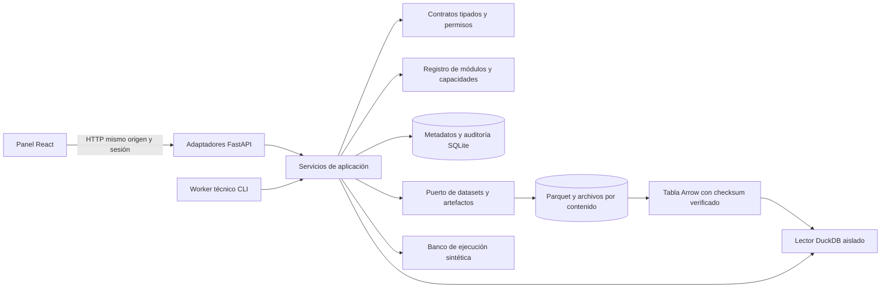

# Arquitectura de la plataforma

Documento: ARCH-001 · Versión: 2 · Actualizado: 2026-10-20 · Idioma: es

Fuente canónica: [inglés](../../en/architecture/platform.md), ARCH-001 v2; traducción sincronizada. Alcance: diseño base de III.A; la implementación y sus pruebas se registran en [aceptación](../../phase-iii/acceptance.md). Una descripción de diseño no certifica una capacidad operativa.

## 1. Diagnóstico y restricciones

La base aceptada de Fase II (`f8f4ff8`) contiene documentación científica, 53 trabajos examinados y H-00–H-24, sin código de aplicación, laboratorio instalado ni experimentos financieros. Se conservan documentos y resultados adversos. C1/C3 siguen como preguntas primarias, C2 como comparación de riesgo y C4/C5 como reservas; la arquitectura no debe imponer ganadora, cantidad de activos, exchange o frecuencia.

La [solicitud de Fase III](../../phase-iii/REQUEST.es.md) autoriza arquitectura, plataforma funcional y pruebas técnicas sintéticas. Quedan fuera datasets financieros, experimentos empíricos, entrenamiento financiero real, paper trading prospectivo, agentes de producción, gastos y órdenes reales. USD es la referencia contable; USDT/USDC son instrumentos distintos con valoración explícita. España sigue como jurisdicción inicial, sin certificar proveedores ni productos.

Los requisitos funcionales son consulta de hipótesis, procedencia de datasets, transformaciones y ejecuciones técnicas reproducibles, resultados/fallos inspeccionables, descubrimiento de módulos y una web real. Los no funcionales son sustitución de implementaciones, integridad temporal, recursos acotados, recuperación persistente, validación tipada, permisos explícitos, auditoría, instalación reproducible y mantenimiento bilingüe. No se prometen latencia, capacidad ni rendimiento financiero sin medirlos.

## 2. Despliegue y tecnologías

Un repositorio y un **monolito modular** con proceso HTTP y worker separado. Comparten contratos, servicios y almacenamiento persistente; el estado de trabajos no depende de memoria privada del proceso.

| Capa | Base y motivo | Alternativa y condición de reconsideración |
|---|---|---|
| Runtime/API | Python 3.12, FastAPI, Pydantic 2: validación tipada y esquema API generado | Sustituir framework mediante servicios; fijar versiones resueltas |
| Metadatos | SQLAlchemy 2 + Alembic; SQLite en un host y transacciones explícitas | PostgreSQL si concurrencia/despliegue medidos lo justifican; las pruebas SQLite no lo certifican |
| Datos/artefactos | Parquet y archivos inmutables direccionados por contenido; lector DuckDB | Almacenamiento de objetos mediante puerto si volumen/retención lo requieren; SQL no almacena todos los ticks |
| Web | React + TypeScript + Vite; SPA compilada servida en el origen API | El renderizado de servidor de Next.js no aporta valor esencial al panel local autenticado |
| Gráficos | Adaptador de Lightweight Charts conservando atribución exigida | Sustituir renderizador sin modificar transformaciones científicas; no presumir dibujos avanzados incluidos |
| Trabajos | Registros SQL duraderos y worker CLI | Broker/planificador distribuido solo ante necesidad justificada |
| Simulación | Banco sintético acotado de contabilidad spot determinista | Integrar motor maduro mediante puerto antes de backtesting empírico; no convertir el banco en motor financiero sin revisión |

La investigación tecnológica acompaña comparaciones oficiales y licencias. Antes de instalar se comprueban licencia, compatibilidad Python y versión fijada; adoptar framework, integrar biblioteca y reutilizar patrones son decisiones diferentes. Esta base no necesita Redis, streaming distribuido, Kubernetes, framework autónomo ni SDK de exchange.

## 3. Dominios y dependencias

Se representan los quince dominios enumerados en la solicitud; no requieren quince paquetes. «Preparado» significa contratos/registros, no funcionalidad financiera terminada. Todos dependen de contratos Core; ninguno depende de la implementación Web.

| Dominio | Responsabilidad y dependencia pública | Alcance III y ampliación posterior |
|---|---|---|
| Core Platform | Configuración, contratos, permisos, manifiestos, errores y eventos | Base funcional; sin cargador de código arbitrario de terceros |
| Market Data | Instrumento, tiempos, calidad, dataset y almacenamiento | Generación/validación/almacenamiento sintéticos; conectores futuros |
| Research Lab | Hipótesis, transformaciones y comparaciones técnicas; Data + Experiments | Laboratorio sintético funcional; protocolos científicos en IV |
| ML & Models | Contratos versionados de fit/predict y metadatos; Data | Interfaces y sustituciones técnicas; ajuste financiero futuro |
| Experiment Management | Especificaciones, trabajos, código/entorno/semilla, resultados y artefactos | Ciclo técnico persistente; sin búsqueda ilimitada |
| Backtesting | Puertos estrategia/riesgo/ejecución; Data + Portfolio + Risk | Solo banco técnico; integración de motor maduro futura |
| Paper Trading | Contabilidad virtual prospectiva, adaptadores y reconciliación | Módulo previsto e inactivo; feed y ejecución futuros |
| Trading Engine | Intenciones validadas, ejecución autorizada y reconciliación | Inactivo; sin adaptador real, claves, rutas ni cuenta financiada |
| Risk Management | Decisiones independientes preorden, exposición y margen | Controles sintéticos; límites operativos y liquidaciones futuros |
| Portfolio Analytics | Saldos, posiciones, costes y atribución por moneda | Contabilidad spot técnica; analítica general/margen futuros |
| Charting & Technical Analysis | Representación de series tipadas; cálculo científico mediante Lab | Gráfico reutilizable; extensiones mediante capacidades |
| News Intelligence | Fuentes versionadas, eventos/entidades/sentimiento; Data | Ingesta/análisis futuros; textos nunca ejecutados como instrucciones |
| AI Researcher | Propuestas, evidencia, duplicados, presupuestos y revisión | Solo registros/permisos; bucle autónomo y llamadas a modelos futuros |
| Alerts & Notifications | Eventos operativos, deduplicación y política de entrega | Fallos/auditoría consultables; notificaciones externas futuras |
| Web Dashboard | Descriptores de secciones y clientes API tipados | Vistas de servicios reales; capacidades futuras visiblemente inactivas |

Los servicios dependen de contratos públicos y puertos inyectados. Los adaptadores de infraestructura implementan los puertos. Un módulo no importa persistencia privada ni UI de otros. Una raíz de composición conecta implementaciones explícitas; cada manifiesto declara ID, versión semántica, dependencias y estados de capacidades. El registro rechaza dependencias ausentes, duplicados y ciclos. Descubrir capacidades no ejecuta paquetes arbitrarios.

Las consultas síncronas devuelven resultados/errores validados. Un bus tipado dentro del proceso admite manejadores opcionales; los registros persistentes de auditoría/trabajos son el historial. El bus no es una cola distribuida ni garantiza entrega exactamente una vez. Una futura entrega externa necesitará outbox transaccional, consumidores idempotentes y política de reejecución.

## 4. Datos y contratos públicos

Contratos con versión de esquema, identificadores estables y unidades validadas. Se rechazan versiones mayores incompatibles; la evolución aditiva debe preservar consumidores y probarse. Los errores públicos incluyen código estable, mensaje seguro e ID de correlación. Importes decimales y monedas explícitas impiden equiparar implícitamente USD y stablecoins; los floats del gráfico no son autoridad contable.

Las observaciones separan evento, primera publicación, disponibilidad del proveedor y recepción local; transformación, señal, decisión y ejecución llevan sus propios tiempos. UTC con zona; tiempos desconocidos siguen desconocidos y no se inventan a partir del evento. La política de disponibilidad escoge la versión observable, no el último dato revisado. Los fixtures ejercitan demora, orden inválido, duplicados, faltantes e identidad del instrumento. El dominio no fija intervalo, exchange ni lista de activos.

Entidades: hipótesis/referencia; instrumento; versión/partición/calidad de dataset; especificación/versión de transformación; modelo/estrategia; especificación congelada de experimento; intento de trabajo; resultado/artefacto; propuesta y evento de auditoría. El descriptor de dataset registra procedencia, clasificación sintética, hash, esquema, partición y cobertura temporal. El artefacto registra checksum, tipo y ejecución productora. Las versiones históricas son inmutables; los cambios de estado se guardan aparte, sin sobrescribir configuraciones/resultados anteriores.

Puertos de almacenamiento/consulta, transformaciones, entrenamiento/inferencia, decisiones de estrategia/señal, ejecución, costes, financiación/margen y riesgo. Órdenes, fills, posiciones y carteras son registros distintos. En la arquitectura objetivo, la estrategia emite una señal o intención; riesgo y ejecución validan los objetivos negociables independientemente. Signal v1 implementa solo un objetivo sintético de cantidad; las predicciones, objetivos de cartera e intenciones generales deberán especificarse antes de admitir un adaptador financiero (véase la revisión complementaria). El contrato puede servir para histórico, prospectivo y real, pero fills, latencia, rechazos, ejecución parcial, funding y reconciliación dependen del adaptador. Lo no soportado se rechaza; no se inventan coste cero ni fills perfectos.

Se puede consultar metadatos de particiones; **el contenido final/holdout se deniega a todos los roles en III**, incluido administrador y agente. API, worker y servicios de datos aplican la misma política. No hay subida de CSV de mercado ni endpoint de SQL general. Abrir holdout requerirá autorización independiente, política auditada y registro inmutable de evaluación, no cambiar una casilla de UI.

## 5. Laboratorio reproducible y trabajos persistentes

El proceso captura su identidad de software cargado y rechaza cambios de código ejecutable/dependencias hasta reiniciar API y worker. Antes de ejecutar se congelan referencias exactas de hipótesis (tipo, ID, versión, hash), hashes de datos/transformaciones, parámetros, semilla, revisión de código/identidad de cambios locales, versiones de entorno/dependencias y protocolo. Los informes distinguen éxito técnico, fallo, resultado negativo e inconcluyente de validación financiera. Las comparaciones muestran diferencias sin clasificar configuraciones ajenas como evidencia. La reproducción determinista compara entradas/resultados estables separadamente de tiempos e IDs de ejecución.

El runner acepta solo tareas sintéticas acotadas. Persiste estados en cola/en ejecución/completado/fallido/interrumpido, tiempos, resultado/error e historial. La reclamación atómica evita dos propietarios. La finalización condicional evita resultados duplicados. Tras caída, los trabajos abandonados se recuperan explícitamente como interrumpidos/fallidos; un reintento será otro intento enlazado. No se informa éxito ni se repiten silenciosamente efectos externos. La secuencia archivo/transacción evita publicar descriptores de artefactos ausentes; mantenimiento detecta contenido huérfano.

Los contratos de particiones temporales/walk-forward describen desarrollo, validación y evaluación final ordenados con restricciones de disponibilidad. Aquí se preparan y prueban con registros sintéticos, sin búsqueda empírica ni evaluación repetida de holdout. Frecuencia, horizonte, número de ensayos y candidatas siguen el proceso aceptado de II.

## 6. Web y gráficos

El panel consume respuestas API reales para estado/salud, H-00–H-24, datasets/procedencia, experimentos/trabajos técnicos, resultados/artefactos, gráficos, capacidades y auditoría/errores. Estados vacío, cargando, sin permiso y fallido son visibles. Los datos sintéticos y resultados técnicos se etiquetan siempre. Una función pendiente figura como capacidad inactiva documentada, nunca como botón ficticio.

Descriptores de secciones y acceso API tipado compartido; sin lógica científica dentro de páginas. El adaptador gráfico recibe series normalizadas, velas/volumen cuando existan y descriptores de superposiciones. Los indicadores se calculan mediante transformaciones backend versionadas, no operaciones visuales ocultas. Se puede sustituir renderizador independientemente. Dibujos, sincronización multigráfico, comparaciones, watchlists, screeners, calendarios, alertas, operaciones y predicciones serán capacidades separadas con datos/permisos propios; no se promete paridad con TradingView.

## 7. Seguridad, agentes y separación operativa

Por defecto loopback, propietario local y denegación de permisos no concedidos. Credencial inicial local fuera de Git; nunca se solicitan secretos de exchange. Sesiones de servidor, cookies HttpOnly, caducidad/revocación y defensa CSRF del mismo origen; cookies seguras y TLS antes de despliegue remoto. Admin, researcher, viewer y agent tienen listas explícitas de permisos. Agent queda limitado a propuestas/metadatos, nunca órdenes, holdout ni herramientas arbitrarias. Los endpoints mutadores comprueban permisos sin depender de la UI.

Validar cargas acotadas, IDs/rutas seguros, límites de recursos y campos inesperados. No exponer shell, código, fetch de URLs, filesystem ni SQL arbitrarios. Redactar secretos y respuestas de error; diagnósticos detallados con acceso controlado. Se persisten denegaciones de autorización de servicio/dominio, fallos CSRF autenticados y mutaciones sensibles. Los controles de entrada de host/origen, tamaño y esquema no registran todos sus rechazos; la monitorización completa de entrada queda como condición de admisión de despliegue. La auditoría da trazabilidad, no resistencia a manipulación por el administrador del host. Un sistema operativo comprometido queda fuera de esta garantía de aislamiento.

Las propuestas conservan URLs/hashes, procedencia, versión de modelo/prompt cuando proceda, fundamento, refutación, duplicados, presupuesto solicitado y revisión. El texto externo no es confiable. Sus instrucciones no se ejecutan; una propuesta no modifica permisos, amplía presupuestos, cambia estrategias/riesgo reales ni se autoriza a sí misma. Agentes futuros necesitarán concesiones acotadas, contabilidad de consumo, revisión y revocación.

Investigación histórica, paper prospectivo y ejecución real requieren identidades autorizadas distintas, listas de adaptadores, espacios de almacenamiento y políticas de riesgo/control. III no incorpora camino ejecutable hacia trading real: `live=true` no activa un adaptador inexistente. Paper futuro requiere servicio propio, recuperación/reconciliación y capital virtual separado, además de aprobación. Real añade acceso y límites aprobados, parada de emergencia y reconciliación; compartir contratos no evita estas condiciones.

## 8. Instalación, recuperación, costes y orden de desarrollo

Backend, frontend, pruebas, migraciones y documentación EN/ES en el mismo repositorio. Versionar lockfiles y migraciones; excluir datos de ejecución, credenciales, caches y artefactos generados. Instalación desde dependencias fijadas, inicialización de base vacía, importación de IDs históricos, compilación SPA y arranque API/worker opcional mediante comandos documentados. El endpoint público de salud solo indica que el proceso responde. La composición comprueba compatibilidad del esquema antes del arranque; las consultas autenticadas de datos/estado ejercitan almacenamiento. Que el proceso responda no garantiza disponibilidad continua del almacenamiento. Ante esquema/configuración incompatibles, abortar sin recrear datos destructivamente.

Migrar antes del arranque, respaldar antes de actualizar, restauración/rollback controlados y probar migración sobre base vacía. Backups SQLite deben respetar escrituras/WAL; copiar coherentemente base y manifiestos de artefactos. Recuperar trabajos/artefactos sin borrar fallos. Logs estructurados, IDs de correlación, errores persistentes y vista de salud constituyen observabilidad inicial; correo/webhooks y atención continua son necesidades futuras, no un servicio garantizado aquí.

Informática personal y paquetes libres no implican nuevos contratos, pero CPU, disco, mantenimiento y desarrollo sí tienen coste. Comenzar con fixtures acotados, un worker y almacenamiento local. Medir antes de cloud o paralelismo. Separar adquisición de históricos, desarrollo/validación y operación recurrente. Feeds premium, llamadas LLM, PostgreSQL gestionado y cloud quedan sin contratar y sujetos a autorización.

Orden: **(1)** arquitectura/licencias y contratos; **(2)** configuración, seguridad, registro, persistencia/migraciones; **(3)** datasets, hipótesis, laboratorio/trabajos y banco sintético; **(4)** API/worker; **(5)** UI/gráficos; **(6)** instalación limpia, seguridad, recuperación y pruebas A–F. Solo paralelizar después de existir requisitos comunes. La aceptación demuestra módulo nuevo, capacidad opcional y sustitución de implementación, no solo carpetas. Los fallos esenciales mantienen III abierta; IV requiere autorización nueva.
